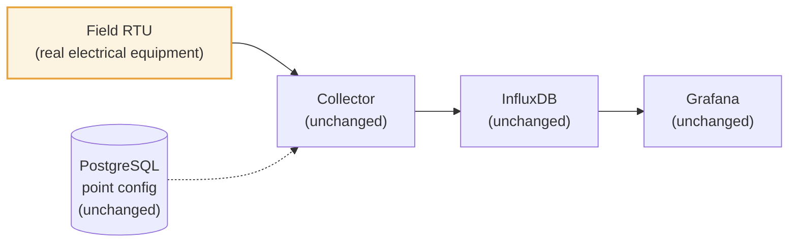
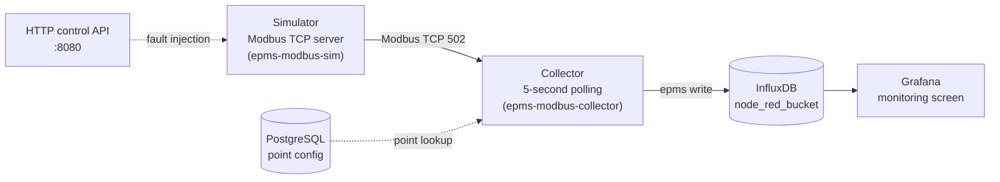
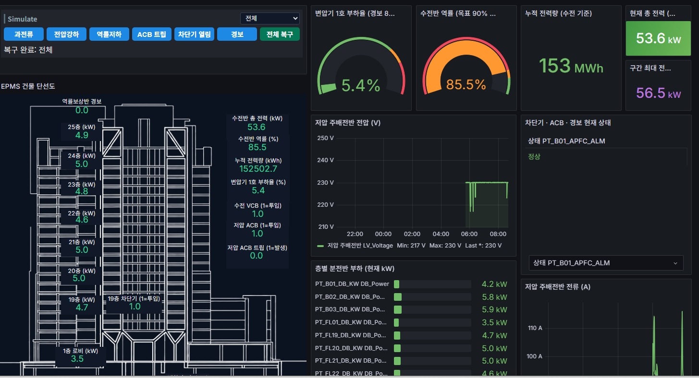

# EPMS Modbus Monitoring System Test Demo

🌐 [한국어](README.md) | **English**

📄 [프로젝트 문서 (한국어)](https://ykn9080.github.io/epms_modbus/) · [Project docs (English)](https://ykn9080.github.io/epms_modbus/en/)

A simulation environment for testing a Modbus-based electrical facility monitoring system installed in a building. Without any physical equipment, it covers the full flow from **device → collection → storage → anomaly monitoring → visualization**, so you can verify the workflow and operating procedures.

> **Key point:** Replace the simulator at the edge with a real RTU, and the collector, DB, InfluxDB, and Grafana can be used as-is.

## Purpose

- Build and understand the data flow of a Modbus-based electrical monitoring system.
- Practice how to check and respond when an anomaly occurs.
- Rehearse operating procedures and fault response without physical equipment.

## Practical Use: Replace Only the Edge RTU



| Scope | Details |
|---|---|
| **Replace** | Simulator → real RTU; field unit ID / IP / port settings; verify the register map against the device manual |
| **Keep** | Collector polling and fault isolation logic, DB point configuration, InfluxDB storage, Grafana dashboards |

For sites using RS-485, a Modbus TCP gateway minimizes changes to the collector configuration.

## Features

- **Building power model:** Calculates total building load from a time-of-day occupancy curve and aggregates it level by level.
- **Modbus TCP server:** Provides 15 devices (unit ID 1–15) as independent slaves.
- **Fault injection:** Inject and clear overcurrent, voltage sag, low power factor, trip, alarm, and open states via HTTP API or console commands.
- **Configuration-driven collection:** Uses point definitions from PostgreSQL first, and falls back to `point_map.yaml` on failure.
- **Time-series storage and visualization:** Stores data in the InfluxDB `epms` measurement and builds monitoring screens in Grafana.

## Architecture



## Power Hierarchy

| Unit | Device | Role | Notes |
|---|---|---|---|
| 1 | B01_HV | Main switchboard (HV) | Top level, ST status |
| 2 | B01_TR01 | Transformer #1 | Alarm |
| 3 | B01_LV | Low-voltage main distribution board | ST, TRIP |
| 4 | B01_APFC | Power factor correction panel | No power flow, alarm only |
| 5 | B01_DB | Distribution board | Weight 0.07 |
| 6 | FL01_DB | Distribution board | |
| 7 | FL19_DB | Distribution board | ST |
| 8–13 | FL20–FL25_DB | Distribution boards | |
| 14 | B02_DB | Distribution board | |
| 15 | B03_DB | Distribution board | |

- Power flows from top to bottom, and the sum of each lower level becomes the value of the level above.
- The 11 distribution boards split the building load by weight (0.06–0.10).
- The power factor correction panel carries no power and only handles alarms.

## Simulator Operation

1. **Time-of-day occupancy:** Interpolates the daily occupancy curve per minute to get building utilization.
2. **Building load calculation:** Computes a value between a 30 kW base and a 520 kW peak, with ±2% variation.
3. **Hierarchical aggregation:** Builds upper-level values in order: distribution board sum → LV board → transformer → main switchboard.
4. **Register update:** Writes float32 values as two words (ABCD order) into the SDM630 map every second.

Upper levels are computed as the sum of lower levels, not as independent random values, so totals always match.

## Directory Structure

```
.
├── simulator.py        # Power model, Modbus server, HTTP control API
├── collector.py        # Modbus polling, InfluxDB writes
├── register_map.py     # Input register map, float32 encode/decode
├── point_map.yaml      # Point configuration (fallback when DB is unavailable)
├── requirements.txt
├── Dockerfile
├── docs/
│   ├── index.html      # Project page (Korean)
│   ├── en/index.html   # Project page (English)
│   └── grafana.png     # Grafana monitoring screen
└── docker-compose.yml  # Top-level service definitions
```

## Requirements

- Docker, Docker Compose
- InfluxDB 2.x, PostgreSQL 15 (included in compose)
- Python 3.12 (not needed when running in containers)

## Environment Variables

Set the following values in a `.env` file.

| Variable | Description |
|---|---|
| `POSTGRES_USER`, `POSTGRES_PASSWORD`, `POSTGRES_DB` | PostgreSQL connection info for point configuration |
| `INFLUXDB_ORGANIZATION` | InfluxDB organization name |
| `INFLUX_COLLECTOR_TOKEN` | Token the collector uses to write to InfluxDB |

| Variable | Default | Description |
|---|---|---|
| `MODBUS_PORT` | `5020` (`502` in Dockerfile) | Modbus TCP port |
| `CONTROL_PORT` | `8080` | Control API port |
| `MODBUS_HOST` | `127.0.0.1` | Simulator address used by the collector |
| `POLL_INTERVAL_S` | `5` | Polling interval (seconds) |
| `PG_DSN` | (none) | PostgreSQL connection string for point config |
| `POINT_MAP` | `point_map.yaml` | Path to the fallback YAML file |

## Running

```bash
# Build and start the simulator and collector
docker compose up -d --build epms-modbus-sim epms-modbus-collector

# Check collector logs (including DB load status)
docker logs epms-modbus-collector 2>&1 | grep -E "point_map|DB 로드 실패"
```

On success, you will see `point_map: DB에서 25개 포인트 로드` and `적재 N개 포인트` in the logs. If the DB load fails, the log shows `YAML에서 로드` and collection continues.

## Fault Injection

### HTTP API

```bash
# Inject overcurrent on unit 7
curl -X POST "http://localhost:8080/inject?scenario=OVERCURRENT&unit=7"

# Clear faults on all units
curl -X POST "http://localhost:8080/inject?scenario=CLEAR&unit=all"

# Query current status
curl "http://localhost:8080/status"
```

| Scenario | Effect |
|---|---|
| `OVERCURRENT` | Current +25% |
| `VOLTAGE_SAG` | Voltage −17% |
| `LOW_PF` | Power factor fixed at 0.70 |
| `TRIP` | Breaker trip (TRIP=1, ST=0) |
| `ALARM` | Alarm contact ON |
| `OPEN` | Breaker open (ST=0) |
| `CLEAR` | Clear all faults and DI states |

### Console Command

Attach to the simulator container and enter `<unit|all> <fault>`.

```
7 overcurrent
all clear
```

## Operating Procedure

1. **Start:** Bring up the simulator and collector with `docker compose up -d`.
2. **Verify collection:** Check the collector logs for point loading and writes.
3. **Inject a fault:** Trigger an event such as overcurrent or trip via the HTTP API.
4. **Check the screen:** Confirm in Grafana that the anomaly is detected and states change.

Knowing in advance which values change for each fault type on the monitoring screen lets you respond quickly during a real incident.

## Grafana Monitoring Screen



- **Top:** Fault injection buttons and full reset
- **KPIs:** Total power, power factor, cumulative energy, transformer load ratio
- **Single-line diagram:** Per-floor distribution board power and breaker status
- **Bottom:** Voltage and current trends, load per distribution board

After injecting a fault, the status panels and charts update immediately, and return to normal values after recovery.

## Modbus Register Map

Based on SDM630. Float32 values are sent as two 16-bit registers, high word first (ABCD order).

| Key | Address (0-base) | Unit | Description |
|---|---|---|---|
| `v_l1`, `v_l2`, `v_l3` | 0x0000, 0x0002, 0x0004 | V | Phase voltage |
| `i_l1`, `i_l2`, `i_l3` | 0x0006, 0x0008, 0x000A | A | Current |
| `p_l1`, `p_l2`, `p_l3` | 0x000C, 0x000E, 0x0010 | W | Active power per phase |
| `pf_l1` | 0x001E | - | Power factor |
| `p_total` | 0x0034 | W | Total active power |
| `s_total` | 0x0038 | VA | Total apparent power |
| `freq` | 0x0046 | Hz | Frequency |
| `kwh_import` | 0x0156 | kWh | Total imported energy (verify against manual) |

When connecting a real device, first confirm that the addresses and data formats in the device manual match this map.

## Data Model

- **Measurement:** `epms`
- **Tags:** `site_id`, `asset_id`, `point_id`, `point_name`, `unit`
- **Field:** `value` (float)

## Point Configuration

The collector joins the following tables to get the points to read.

- `tb_point`: point definitions (Modbus type, key, address, scale)
- `tb_asset`: device definitions (Modbus unit ID)
- `tb_space`, `tb_site`: location and site info

If the DB lookup fails, the collector uses `point_map.yaml`. Points can be added through the DB without code changes.

## Troubleshooting

### DB load falls back to YAML

If the collector tries to connect before PostgreSQL is ready, it fails with `Connection refused` and falls back to YAML. Compare the log timestamp with the PostgreSQL startup log to confirm a startup-order issue. To prevent this, add a health check to `postgres` and set `condition: service_healthy` in the collector's `depends_on`.

### Network error when using a fixed IP

The error `invalid endpoint settings: no configured subnet contains IP address ...` occurs when a fixed IP is assigned without defining a subnet on the network. The collector connects by service name (`epms-modbus-sim`), so removing the fixed IP is recommended.

## Limitations and Next Steps

- The `kwh_import` address (0x0156) needs verification against the SDM630 manual.
- Fault states are kept only in memory and reset when the simulator restarts.
- Sites using RS-485 need additional Modbus TCP gateway configuration.
- A Grafana Canvas-based Modbus demo screen is planned to be completed.

## License

<!-- Please choose a license, e.g. MIT -->
