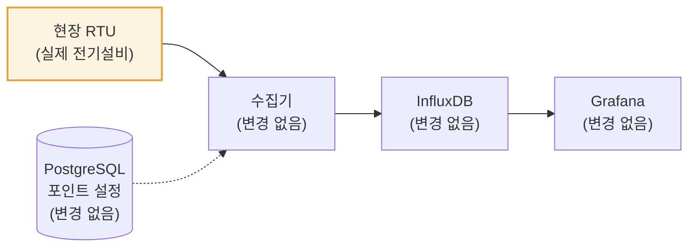
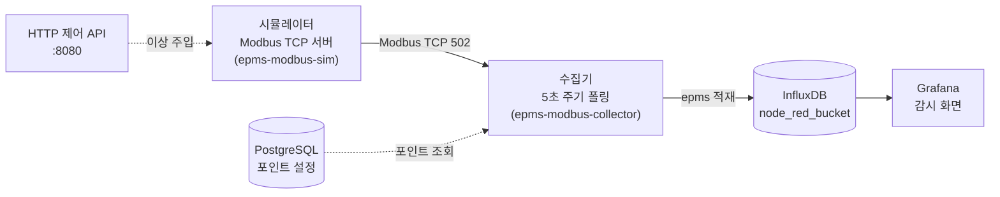
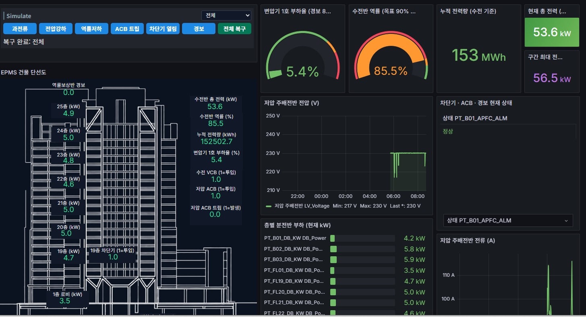

# EPMS Modbus 감시 시스템 테스트 데모

🌐 **한국어** | [English](README.en.md)

📄 [프로젝트 문서 (한국어)](https://ykn9080.github.io/epms-modbus/) · [Project docs (English)](https://ykn9080.github.io/epms-modbus/en/)

Modbus 기반으로 설치된 건물의 전기설비 감시 시스템을 테스트하기 위한 시뮬레이션 환경입니다. 실제 설비 없이도 **장비 → 수집 → 저장 → 이상 감시 → 시각화**까지의 흐름과 운영 방법을 검증할 수 있도록 구성했습니다.

> **핵심:** 말단의 시뮬레이터를 실제 RTU로 교체하면, 수집기·DB·InfluxDB·Grafana는 그대로 사용할 수 있는 구조입니다.

## 제작 목적

- Modbus 기반 전기설비 감시 시스템의 **데이터 흐름**을 직접 구성하고 이해합니다.
- 이상 발생 시 **확인과 대응 절차**를 실습합니다.
- 현장 장비 없이도 운영 절차와 장애 대응을 미리 연습합니다.

## 실무 적용: 말단 RTU만 교체



| 구분 | 내용 |
|---|---|
| **교체 범위** | 시뮬레이터 → 실제 RTU, 현장 unit ID / IP / 포트 설정, 장비 매뉴얼 기준 레지스터 맵 확인 |
| **유지 범위** | 수집기 폴링 및 장애 격리 로직, DB 포인트 설정, InfluxDB 적재, Grafana 대시보드 |

RS-485 구간을 사용하는 현장이라면 Modbus TCP 게이트웨이를 두면 수집기 설정 변경을 최소화할 수 있습니다.

## 주요 기능

- **건물 전력 모델:** 시간대별 점유율 곡선으로 건물 전체 부하를 계산하고, 계층 순서대로 합산합니다.
- **Modbus TCP 서버:** 장비 15대(unit ID 1~15)를 독립된 슬레이브로 제공합니다.
- **이상 상황 주입:** HTTP API 또는 콘솔 명령으로 과전류, 전압 저하, 역률 저하, 트립, 알람, 개방 상태를 주입하고 해제합니다.
- **설정 기반 수집:** PostgreSQL의 포인트 정의를 우선 사용하고, 실패 시 `point_map.yaml`로 대체합니다.
- **시계열 적재와 시각화:** InfluxDB `epms` measurement에 저장하고 Grafana에서 감시 화면을 구성합니다.

## 아키텍처



## 전력 계층

| Unit | 장비명 | 역할 | 비고 |
|---|---|---|---|
| 1 | B01_HV | 수전반 | 최상위, ST 상태 |
| 2 | B01_TR01 | 변압기 1호 | 알람 |
| 3 | B01_LV | 저압 주배전반 | ST, TRIP |
| 4 | B01_APFC | 역률보상반 | 전력 없음, 알람 전용 |
| 5 | B01_DB | 분전반 | 가중치 0.07 |
| 6 | FL01_DB | 분전반 | |
| 7 | FL19_DB | 분전반 | ST |
| 8~13 | FL20~FL25_DB | 분전반 | |
| 14 | B02_DB | 분전반 | |
| 15 | B03_DB | 분전반 | |

- 전력은 위에서 아래로 흐르며, 하위 계층의 합이 상위 계층 값이 됩니다.
- 분전반 11면은 가중치(0.06~0.10)로 건물 부하를 나눠 가집니다.
- 역률보상반은 전력을 흘리지 않고 알람만 담당합니다.

## 시뮬레이터 동작 방식

1. **시간대별 점유율:** 시간대 곡선을 분 단위로 보간해 건물 사용률을 구합니다.
2. **건물 부하 계산:** 기본 30kW와 피크 520kW 사이에서 값을 계산하고 ±2% 변동을 줍니다.
3. **계층 합산:** 분전반 합계 → 저압반 → 변압기 → 수전반 순으로 상위 값을 만듭니다.
4. **레지스터 기록:** SDM630 맵에 float32 두 워드(ABCD)로 1초마다 갱신합니다.

상위 계층은 독립 난수가 아니라 하위 합으로 계산하므로, 합계가 항상 하위 값과 일치합니다.

## 디렉터리 구조

```
.
├── simulator.py        # 전력 모델, Modbus 서버, HTTP 제어 API
├── collector.py        # Modbus 폴링, InfluxDB 적재
├── register_map.py     # 입력 레지스터 맵, float32 인코딩/디코딩
├── point_map.yaml      # 포인트 설정 (DB 실패 시 대체용)
├── requirements.txt
├── Dockerfile
├── docs/
│   └── grafana.png     # Grafana 감시 화면
└── docker-compose.yml  # 상위 디렉터리: 전체 서비스 정의
```

## 요구 사항

- Docker, Docker Compose
- InfluxDB 2.x, PostgreSQL 15 (compose에 포함)
- Python 3.12 (컨테이너 실행 시 불필요)

## 환경 변수

`.env` 파일에 다음 값을 설정합니다.

| 변수 | 설명 |
|---|---|
| `POSTGRES_USER`, `POSTGRES_PASSWORD`, `POSTGRES_DB` | 포인트 설정을 읽을 PostgreSQL 접속 정보 |
| `INFLUXDB_ORGANIZATION` | InfluxDB 조직 이름 |
| `INFLUX_COLLECTOR_TOKEN` | 수집기가 InfluxDB에 쓰기 위한 토큰 |

| 변수 | 기본값 | 설명 |
|---|---|---|
| `MODBUS_PORT` | `5020` (Dockerfile에서 `502`) | Modbus TCP 포트 |
| `CONTROL_PORT` | `8080` | 제어 API 포트 |
| `MODBUS_HOST` | `127.0.0.1` | 수집기가 접속할 시뮬레이터 주소 |
| `POLL_INTERVAL_S` | `5` | 수집 주기(초) |
| `PG_DSN` | (없음) | 포인트 설정 DB 접속 문자열 |
| `POINT_MAP` | `point_map.yaml` | YAML 대체 파일 경로 |

## 실행 방법

```bash
# 시뮬레이터와 수집기 빌드 및 실행
docker compose up -d --build epms-modbus-sim epms-modbus-collector

# 수집 로그 확인 (DB 로드 여부 포함)
docker logs epms-modbus-collector 2>&1 | grep -E "point_map|DB 로드 실패"
```

정상 실행되면 `point_map: DB에서 25개 포인트 로드`와 `적재 N개 포인트` 로그가 출력됩니다. DB 로드에 실패하면 `YAML에서 로드` 로그가 나오며, 이 경우 수집은 계속됩니다.

## 이상 상황 주입

### HTTP API

```bash
# 장비 7번에 과전류 주입
curl -X POST "http://localhost:8080/inject?scenario=OVERCURRENT&unit=7"

# 모든 장비의 이상 해제
curl -X POST "http://localhost:8080/inject?scenario=CLEAR&unit=all"

# 현재 상태 조회
curl "http://localhost:8080/status"
```

| 시나리오 | 동작 |
|---|---|
| `OVERCURRENT` | 전류 25% 상승 |
| `VOLTAGE_SAG` | 전압 17% 하락 |
| `LOW_PF` | 역률 0.70 고정 |
| `TRIP` | 차단기 트립 (TRIP=1, ST=0) |
| `ALARM` | 알람 접점 ON |
| `OPEN` | 차단기 개방 (ST=0) |
| `CLEAR` | 모든 이상과 DI 상태 초기화 |

### 콘솔 명령

시뮬레이터 컨테이너에 접속해 `<unit|all> <fault>` 형식으로 입력합니다.

```
7 overcurrent
all clear
```

## 운영 절차

1. **기동:** `docker compose up -d`로 시뮬레이터와 수집기를 올립니다.
2. **수집 확인:** 수집기 로그에서 포인트 로드와 적재 여부를 확인합니다.
3. **이상 주입:** HTTP API로 과전류, 트립 같은 이상을 발생시킵니다.
4. **화면 확인:** Grafana에서 이상이 감지되고 상태가 바뀌는지 확인합니다.

이상 종류별로 감시 화면에서 어떤 값이 바뀌는지 미리 알고 있어야 실제 장애 때 빠르게 판단할 수 있습니다.

## Grafana 감시 화면



- **상단:** 이상 주입 버튼과 전체 복구
- **KPI:** 총 전력, 역률, 누적 전력량, 변압기 부하율
- **단선도:** 층별 분전반 전력과 차단기 상태
- **하단:** 전압, 전류 추이와 분전반별 부하

이상을 주입하면 상태 패널과 차트가 즉시 바뀌고, 복구 후 정상값으로 돌아옵니다.

## Modbus 레지스터 맵

SDM630 기준이며, float32 값을 상위 워드부터 두 개의 16비트 레지스터로 전송합니다(ABCD 순서).

| 키 | 주소 (0-base) | 단위 | 설명 |
|---|---|---|---|
| `v_l1`, `v_l2`, `v_l3` | 0x0000, 0x0002, 0x0004 | V | 상전압 |
| `i_l1`, `i_l2`, `i_l3` | 0x0006, 0x0008, 0x000A | A | 전류 |
| `p_l1`, `p_l2`, `p_l3` | 0x000C, 0x000E, 0x0010 | W | 상별 유효전력 |
| `pf_l1` | 0x001E | - | 역률 |
| `p_total` | 0x0034 | W | 총 유효전력 |
| `s_total` | 0x0038 | VA | 총 피상전력 |
| `freq` | 0x0046 | Hz | 주파수 |
| `kwh_import` | 0x0156 | kWh | 총 수입 전력량 (매뉴얼 재확인 필요) |

현장 장비를 연결할 때는 장비 매뉴얼의 주소와 데이터 형식이 이 맵과 일치하는지 가장 먼저 확인해야 합니다.

## 데이터 모델

- **Measurement:** `epms`
- **Tags:** `site_id`, `asset_id`, `point_id`, `point_name`, `unit`
- **Field:** `value` (float)

## 포인트 설정

수집기는 다음 테이블을 조인해 읽을 포인트를 가져옵니다.

- `tb_point`: 포인트 정의 (Modbus 타입, 키, 주소, 스케일)
- `tb_asset`: 장비 정의 (Modbus unit ID)
- `tb_space`, `tb_site`: 위치 및 사이트 정보

DB 조회에 실패하면 `point_map.yaml`을 사용합니다. 포인트를 추가할 때 코드 수정 없이 DB에서 처리할 수 있도록 설계했습니다.

## 문제 해결

### DB 로드가 YAML로 대체되는 경우

수집기가 PostgreSQL이 준비되기 전에 연결을 시도하면 `Connection refused`가 발생하고 YAML로 대체됩니다. 이때는 로그의 시각을 PostgreSQL 기동 로그와 비교해 기동 순서 문제인지 확인합니다. 재발을 막으려면 `postgres`에 헬스체크를 추가하고 수집기의 `depends_on`에 `condition: service_healthy`를 지정합니다.

### 고정 IP 지정 시 네트워크 오류

`invalid endpoint settings: no configured subnet contains IP address ...` 오류는 네트워크에 subnet을 정의하지 않고 고정 IP를 지정했을 때 발생합니다. 수집기는 서비스 이름(`epms-modbus-sim`)으로 접속하므로 고정 IP를 제거하는 것을 권장합니다.

## 한계와 개선 과제

- `kwh_import` 주소(0x0156)는 SDM630 매뉴얼로 재확인이 필요합니다.
- 이상 상태가 메모리에만 있어 시뮬레이터 재시작 시 초기화됩니다.
- RS-485 구간을 쓰는 현장은 Modbus TCP 게이트웨이 설정이 추가로 필요합니다.
- Grafana Canvas 기반 Modbus 시연 화면을 마무리할 예정입니다.

## 라이선스

<!-- 라이선스를 정해 주세요. 예: MIT -->
